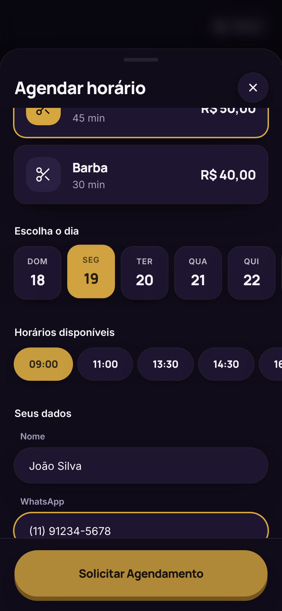
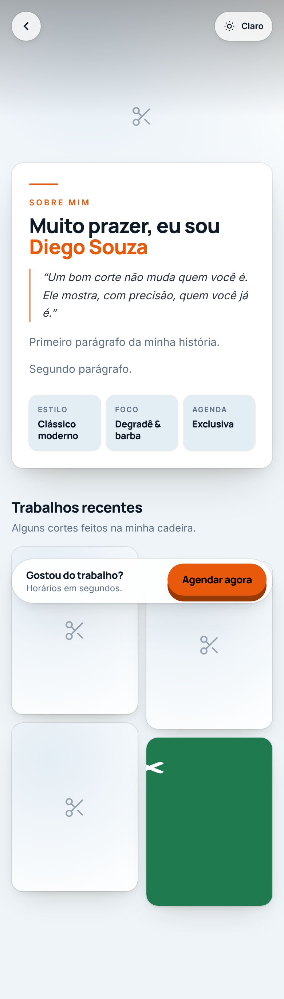
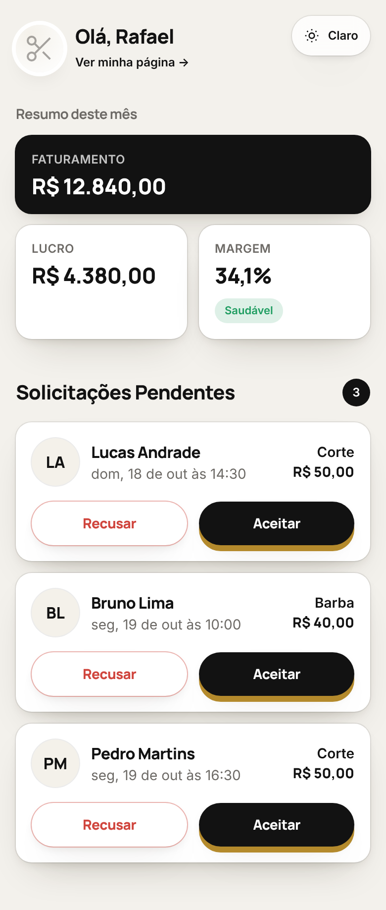
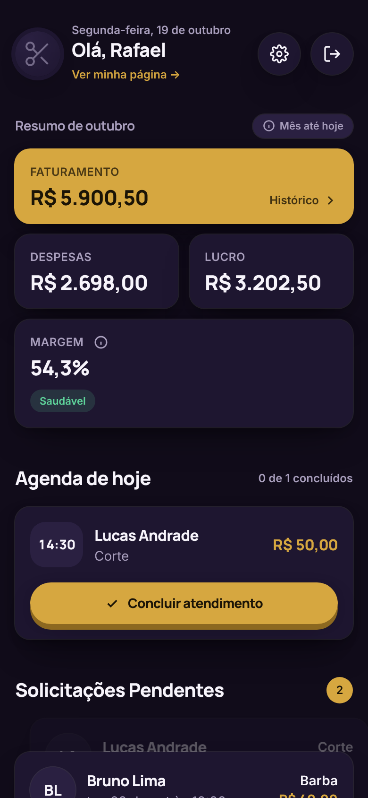
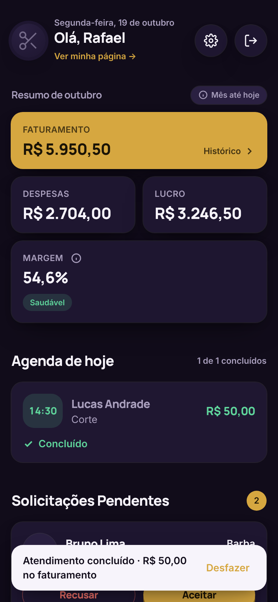
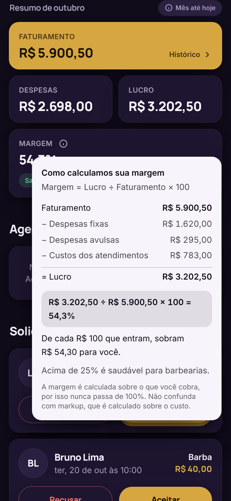
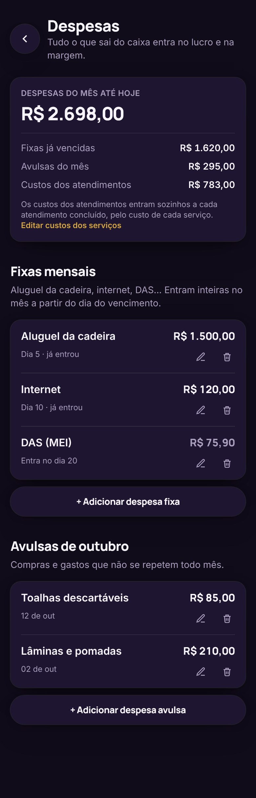
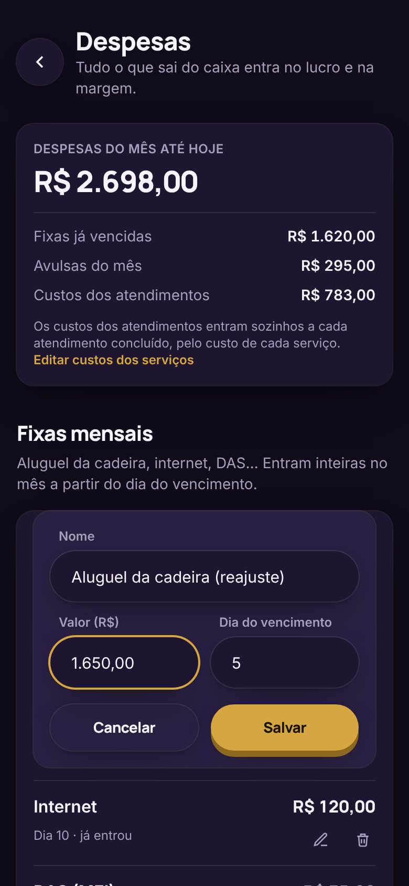
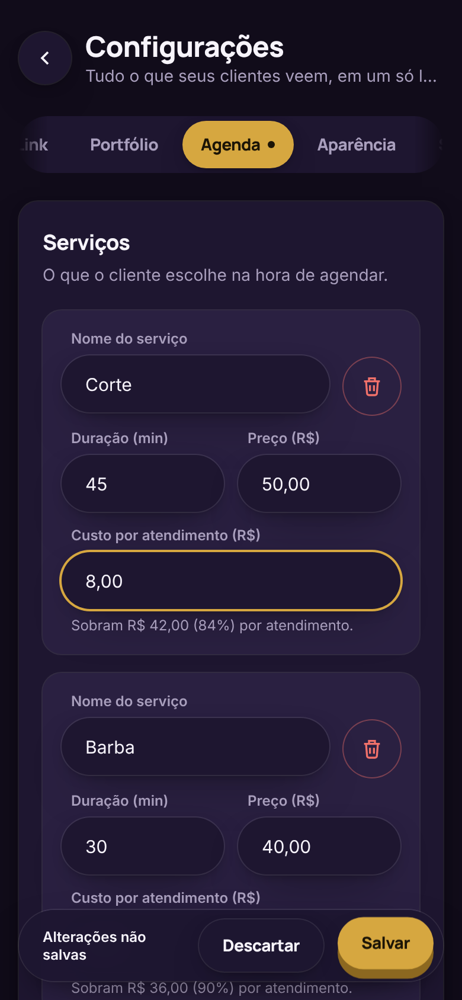

# linkcut
Interface do meu SaaS para barbeiros 

## Telas

Telas no celular (390 px), com dados de exemplo.

<table>
 <tr>
    <td align="center"><br><sub>Painel para rede social</sub></td>
    <td align="center"><br><sub>Agenda Publica</sub></td>
    <td align="center"><br><sub>Portifólio Publico</sub></td>
  </tr>
  <tr>
    <td align="center"><br><sub>Link da Bio</sub></td>
    <td align="center"><br><sub>Agendamento</sub></td>
    <td align="center"><br><sub>Painel no tema claro</sub></td>
  </tr>
  <tr>
    <td align="center"><br><sub>Painel e agenda de hoje</sub></td>
    <td align="center"><br><sub>Concluir atendimento</sub></td>
    <td align="center"><br><sub>Tooltip da margem</sub></td>
  </tr>
  <tr>
    <td align="center"><br><sub>Despesas</sub></td>
    <td align="center"><br><sub>Editar despesa</sub></td>
    <td align="center"><br><sub>Custo por serviço</sub></td>
  </tr>
</table>

## Estrutura

| Pasta | O quê |
|---|---|
| `backend/` | API Laravel 11 (PHP 8.3), DDD pragmático, multi-tenant por `tenant_id`, Passport e 2FA por e-mail ou SMS ([arquitetura](docs/arquitetura-backend.md), [observabilidade](docs/observabilidade.md)) |
| `frontend/` | SPA Vue 3 + Tailwind |
| `docker-compose.yml` + `Makefile` | MySQL, API, fila, Pulse, Mailpit e SPA |

```bash
make up         # sobe tudo: SPA :5173 · API :8087 · Pulse :8087/pulse · Mailpit :8025 · MySQL :3309
make stop       # para tudo (o banco fica guardado)
make seed       # login de demonstração: rafael@linkcut.app / linkcut123
make test       # testes da API · make test-web: testes do SPA
make help       # todos os comandos
```

Depois de cada `git pull` (na pasta raiz), basta `make up`:
- confere se o Docker está rodando;
- avisa se o Node da sua máquina não é o do projeto (`.nvmrc`, Node 22). Os containers já usam o Node certo;
- devolve ao seu usuário os arquivos criados pelos containers;
- instala sozinho as dependências novas: `composer install` na API e `npm install` no SPA, quando o `package-lock.json` mudou.

Se o SPA ainda reclamar de um pacote que não existe, rode `make reset-web` (reinstala as dependências do zero).

### Testar no celular

1. Deixe o celular e o computador **no mesmo Wi-Fi**.
2. Rode `make up` (ou `make ip`). Ele mostra o endereço, por exemplo `http://192.168.0.15:5173`. Abra esse endereço no navegador do celular.
3. Se não abrir, libere a porta 5173 no firewall do computador. No Ubuntu: `sudo ufw allow 5173/tcp`. No Windows/Mac: permita o Docker na rede local quando o sistema perguntar.

Tudo passa por essa porta: o Vite repassa `/api` e `/storage` para a API. Os links dos e-mails (Mailpit) também usam esse endereço.

**Sem cadeado (`http`), dois recursos não funcionam no celular:** a localização ("Estou na barbearia", "Compartilhar minha localização") e os avisos de novos pedidos (push). Os navegadores só liberam esses dois em `https` ou em `localhost`. Para testá-los no celular (ou colocar o link na bio do Instagram durante os testes), use um túnel `https` do Cloudflare. Com o `make up` rodando, em outro terminal:

```bash
docker run --rm --network host cloudflare/cloudflared:latest tunnel --url http://localhost:5173
```

Abra o endereço `https://….trycloudflare.com` que ele mostrar. O endereço muda a cada vez e só funciona enquanto o computador estiver ligado; para um link fixo, é preciso subir numa VPS.

## Frontend (Vue 3 + Tailwind)

Telas mobile-first. Todas usam a API real, sem dados simulados ([plano da migração](docs/plano-migracao-backend.md)):

| Rota | Tela |
|------|------|
| `/` | Página do linkcut, com o acesso ao painel |
| `/:slug` | Link da Bio de cada barbearia (ex.: `/rafael`) |
| `/:slug/portfolio` | Portfólio / Sobre Mim |
| `/:slug/agendar` | Modal de agendamento (também abre pelo botão "Agendar") |
| `/entrar` | Login do barbeiro (e-mail + senha + código 2FA por WhatsApp ou e-mail) |
| `/painel` 🔒 | Painel do Barbeiro (métricas com tooltip da margem, agenda de hoje e solicitações pendentes) |
| `/painel/historico` 🔒 | Histórico de atendimentos: filtros semana/mês/ano/personalizado, 50/100/200 por página e exportação CSV ([requisitos](docs/requisitos-historico.md)) |
| `/painel/despesas` 🔒 | Despesas fixas e avulsas do mês, mais o custo dos atendimentos ([requisitos](docs/requisitos-despesas.md)) |
| `/painel/configuracoes` 🔒 | Configurações: abas Link, Portfólio, Agenda, Aparência e Segurança (`?aba=`) |

🔒 = só com login. Em desenvolvimento, use a conta de demonstração `rafael@linkcut.app` / `linkcut123`. O código 2FA chega no Mailpit (e-mail) ou em `backend/storage/logs/sms.log` (SMS). Detalhes em [`docs/requisitos-autenticacao.md`](docs/requisitos-autenticacao.md).

O barbeiro recebe um **aviso (push) a cada novo pedido**, no celular ou no computador ([requisitos](docs/requisitos-notificacoes.md)).

O agendamento mostra o **endereço da barbearia**, obrigatório para receber pedidos. O cliente pode compartilhar a localização, e o barbeiro vê a que distância ele está, sem guardar as coordenadas ([requisitos](docs/requisitos-localizacao.md)).

Tudo o que as telas públicas mostram vem das **Configurações** (requisitos em [`docs/requisitos-configuracoes.md`](docs/requisitos-configuracoes.md)), salvas na API (`/api/settings`) e lidas pelo visitante em `/api/public/{slug}`, sem o custo dos serviços. As imagens são enviadas para a API, que as guarda em WebP (até 1600 px). O "Ver minha página" do painel leva ao endereço da barbearia (`/:slug`).

As cores ficam em um único arquivo, `frontend/src/styles/core.css`: 6 paletas, cada uma com versão clara e escura, mais uma cor personalizada opcional. O visitante pode alternar claro/escuro nas páginas públicas pelo botão no canto superior direito.

Sem Docker: `cd frontend && npm install && npm run dev` (a API em `VITE_API_URL`, veja `frontend/.env.example`).
